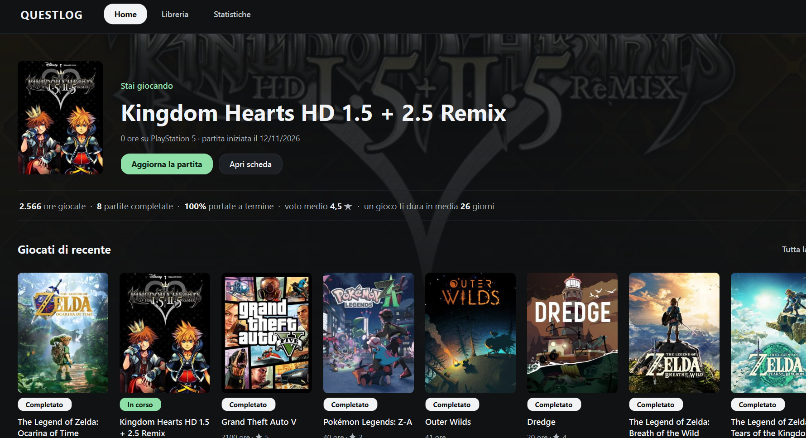
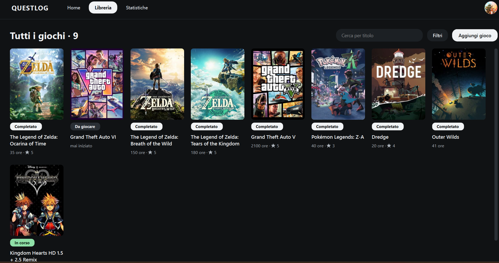
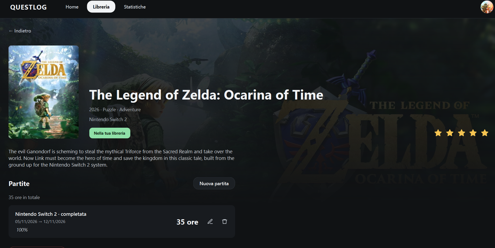
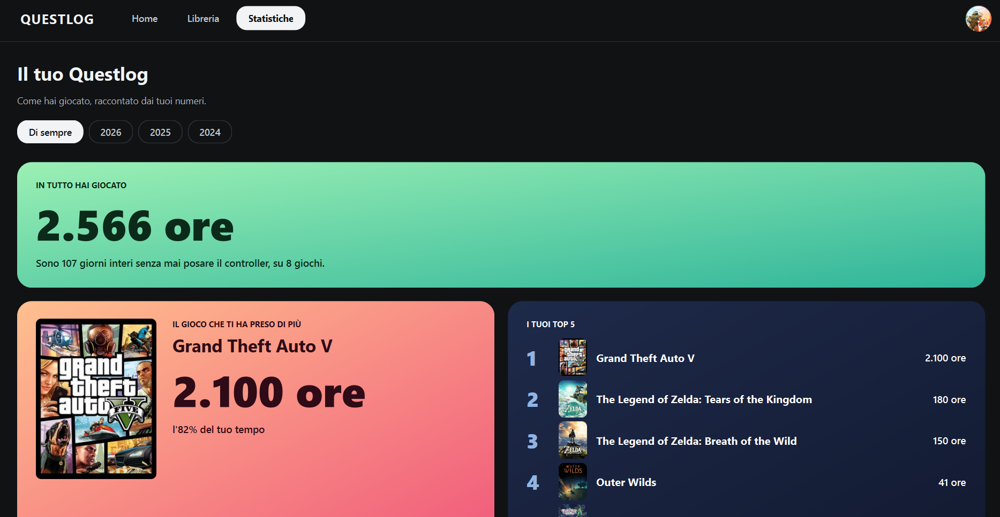

# Questlog

**Il diario dei tuoi videogiochi.** Cerchi un gioco, lo aggiungi alla libreria e tieni traccia di ogni partita: quanto ci hai giocato, quando l'hai finito, cosa ne pensi. A fine anno Questlog ti racconta come hai giocato, in stile *Spotify Wrapped*.

  

## Cosa puoi fare

- **Cercare qualsiasi gioco** nel catalogo di [IGDB](https://www.igdb.com), oppure sfogliare quelli di tendenza e le nuove uscite.
- **Costruire la tua libreria**, con le copertine, un voto da 1 a 5 stelle e le note.
- **Registrare le partite**: piattaforma, ore giocate, date, e se l'hai finita o abbandonata. Puoi rigiocare lo stesso gioco quante volte vuoi.
- **Scoprire le tue statistiche**: ore totali, il gioco più giocato, la console preferita, il tuo profilo da giocatore. Per sempre o anno per anno.
- **Ritrovare tutto su ogni computer**: entri con Google o con la tua email e la libreria è salvata online, nel tuo account.

| Libreria | Scheda del gioco |
|---|---|
|  |  |

  

## Come funziona

1. **Entri** con Google o con email e password.
2. **Aggiungi un gioco**: lo cerchi nel catalogo, apri la sua scheda e lo metti in libreria.
3. **Registri una partita** quando inizi a giocare e la aggiorni quando la finisci.
4. **Guardi le statistiche** e scopri che tipo di giocatore sei.

## Scarica

Questlog sarà disponibile come programma per Windows: si scarica il file `.exe` dalla pagina [Releases](https://github.com/MarcoCapasso/questlog/releases), si apre e si entra con il proprio account.

## Costruito con

Python · PySide6 (Qt) · Supabase · API di IGDB · pandas e matplotlib · pytest

## Roadmap

- [x] App a riga di comando
- [x] Statistiche e grafici
- [x] App desktop con catalogo IGDB
- [x] Account e libreria online
- [ ] Catalogo IGDB senza chiavi nell'app
- [ ] Programma `.exe` da scaricare

## Licenza

Distribuito con licenza MIT. Vedi il file [LICENSE](LICENSE).
